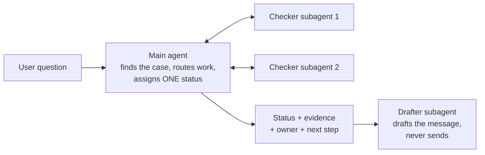

# Supply chain agents

No-code agent designs for supply chain teams. Each one comes with ready-to-paste instructions for a main agent and its subagents, a flow diagram, the questions it answers, and the data it needs.

Each agent is designed as a one-week proof of concept: build it without code in Google's Workflow Builder (formerly Agent Designer) or any agent builder that supports subagents, test it against cases your team has already resolved, and decide whether it's worth a pilot.

| Agent | Process | Problem it solves | What it returns |
| --- | --- | --- | --- |
| [PO Follow-up Assistant](po-follow-up-assistant/) | Procure-to-pay | Buyers scan open POs by hand every morning to find late or unconfirmed supplier orders. **Start here: the simplest agent.** | Lines needing follow-up, and one draft email per supplier |
| [Order Status Assistant](order-status-assistant/) | Order-to-cash | "Where is my order?" questions answered by hand, dozens of times a day. | Answers with status, shipment, tracking and expected delivery |
| [EDI Order Exception Triage](edi-order-exceptions/) | Order-to-cash | EDI purchase orders stuck on hold | Release, fix internally, needs customer, escalate |
| [Deductions Triage](deductions-triage/) | Order-to-cash | Customer short-payments that need research before the dispute deadline | Accept, dispute, needs info, escalate |
| [Three-Way Match Exceptions](three-way-match/) | Procure-to-pay | Supplier invoices blocked because invoice, PO and receipt don't agree | Release, needs receipt, needs buyer, request credit, hold, escalate |
| [Supplier Delay Early Warning](supplier-delay-warning/) | Procure-to-pay and planning | Late supplier deliveries discovered too late | On track, at risk, late but covered, late with shortage risk |
| [Freight Invoice Audit](freight-invoice-audit/) | Logistics | Carrier overbilling on rates, fuel and accessorial charges | Approve, short-pay, hold, escalate |
| [Inventory Risk Review](inventory-risk-review/) | Planning | Stockouts and excess found too late, and slow weekly review prep | OK, stockout risk, excess, obsolete risk |

The EDI agent also includes fictional [sample data and an answer key](edi-order-exceptions/sample-data/) for testing.

## The pattern behind every agent

Every design follows the same rules, which are what make a POC trustworthy:

- **One status per case,** from a short fixed list, so results can be scored against an answer key.
- **Evidence for every finding,** with the source file and row.
- **No invented data.** Missing data leads to "needs info" or "escalate", never a guess.
- **Recommend, never act.** The agents draft messages and suggest fixes. People decide and send.
- **Checkers check, the main agent decides.** Each subagent has one job, which makes it easy to test and fix.

## How to build one in Workflow Builder

1. In the Gemini Enterprise web app, click **+ Create agent**, then **Chat agent**, then **Proceed to builder**.
2. Click the **My Agent** node and paste the name, description and instructions from the agent's `main-agent.md`. Choose a **Model**.
3. Click **Add data sources & tools** to attach the data listed in the agent's README, for example as Google Sheets in a shared drive your admin has connected.
4. Under **Knowledge**, click **Add files** to upload policies and guides.
5. On the **Flow** tab, hover over the main agent, click **Add subagent**, and paste each file from `subagents/`.
6. Test in **Preview**, then click **Create** and share with a small pilot group.

Labels follow Google's documentation as of October 2026. Your admin must turn on Workflow Builder for your web app.

## Before you use real data

- **Sharing an agent shares its data.** Anyone you share it with can ask about everything in its data sources and files. Limit data to what the pilot group already sees.
- **Every threshold is a placeholder.** Each agent's README lists the numbers to replace with your own policy.
- **Use exports for a POC.** Spreadsheet exports are enough to test whether the agent's judgment is right. Integrate after the POC proves value.

## License

MIT. All company names and examples are fictional.
