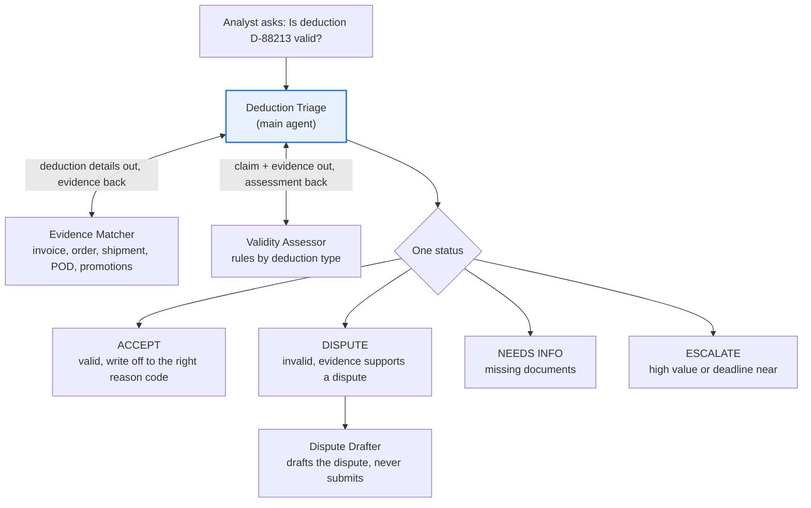

# Deductions Triage agent

**Process:** Order-to-cash (cash application and collections)

Large retail customers often pay less than the invoice amount and take a deduction for a shortage, a pricing difference, a promotion, a damaged shipment or a compliance fine. Each one has to be researched against orders, shipments, contracts and the retailer's rules, usually within a dispute deadline. Unresearched deductions get written off, and that is lost margin.

**POC question:** can an agent classify open deductions as valid or disputable, with evidence, accurately enough that the deductions team trusts it and recovers more cash?

## Design

| Agent | Role |
| --- | --- |
| [Deduction Triage](main-agent.md) | Finds the deduction, gathers evidence, decides the status, routes it |
| [Evidence Matcher](subagents/1-evidence-matcher.md) | Pulls the invoice, order, shipment, proof of delivery and promotion records behind a deduction |
| [Validity Assessor](subagents/2-validity-assessor.md) | Applies the rules for each deduction type and says whether the claim holds up |
| [Dispute Drafter](subagents/3-dispute-drafter.md) | Drafts the dispute text and evidence list for the retailer's portal |

## Questions it answers

- Is deduction D-88213 from Acme Retail valid, and why?
- Why did Northwind short-pay invoice 91002 by $1,240?
- Which open deductions are disputable and still inside the dispute window?
- Which deductions expire in the next 7 days?
- Draft a dispute for the shortage deduction on invoice 91002.
- What are our top deduction reasons by customer this month?

## Data it needs

| Data | What it contains | Typical source | Add as |
| --- | --- | --- | --- |
| Open deductions | Deduction ID, customer, invoice number, amount, reason code, date taken, dispute deadline | AR or cash application export | Data source (Sheet) |
| Invoices | Invoice lines, quantities, prices, dates | ERP billing export | Data source (Sheet) |
| Sales orders and shipments | Order lines, ship dates, ASN sent date, carrier, tracking | ERP and WMS exports | Data source (Sheet) |
| Proof of delivery | Delivered and signed quantities, exceptions noted at delivery | Carrier portal or TMS export | Data source (Sheet or PDFs) |
| Contract prices | Customer, SKU, price, valid dates | Pricing system | Data source (Sheet) |
| Trade promotions | Approved promotions: customer, SKUs, dates, allowance per unit | Trade promotion system | Data source (Sheet) |
| Retailer vendor compliance guides | Each retailer's rules and fine schedule (late ASN, labeling, routing) | Retailer portals | Knowledge (PDFs) |
| Deduction policy | Reason code map, write-off limits, dispute rules, owners | Internal | Knowledge (doc) |

## POC success bar

Test with 20 deductions your team has already resolved; how they were resolved is the answer key.

| Signal | Bar |
| --- | --- |
| Status matches the actual resolution | At least 16 of 20 |
| Evidence cited for every status | 100% |
| Invented amounts, quantities or promotions | Zero |
| Research time per deduction | At least 40% less than today |

## Customize before use

Replace the placeholders in the instructions: the `$2,500` escalation limit, the `7-day` deadline warning, and the `2%` shortage tolerance. Use your deduction policy's numbers.
