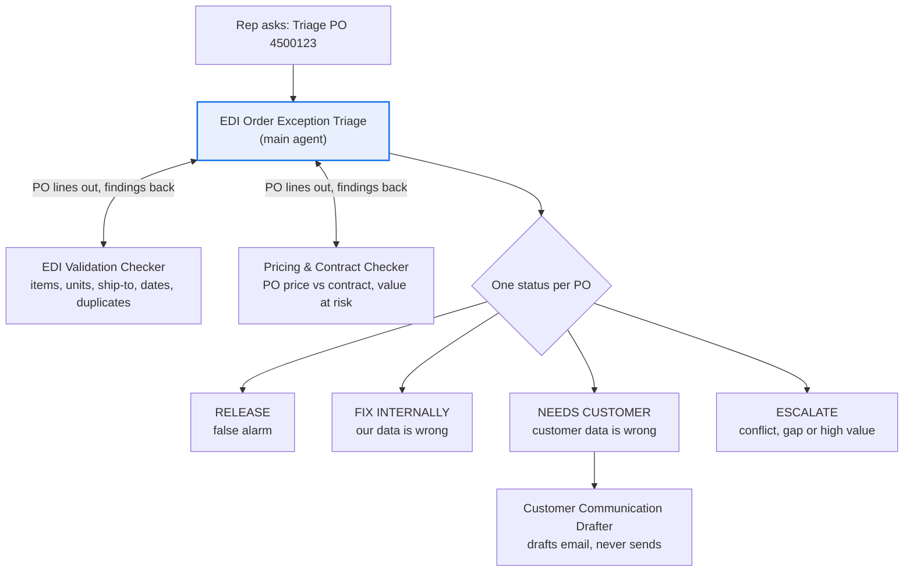

# EDI Order Exception Triage agent

A no-code agent for order-to-cash teams. It diagnoses EDI purchase orders (X12 850) that are on hold, recommends a fix, routes each one to the right owner, and drafts customer emails when the customer needs to act.

Built for Google's Workflow Builder (formerly Agent Designer) in Gemini Enterprise, but the instructions work in any agent builder that supports a main agent with subagents.

**Process:** Order-to-cash (order management)

**POC question:** can an agent triage held EDI orders, find the root cause, and recommend the right fix accurately enough that reps trust it and resolve orders faster?

## Design

Each held PO gets one status:

| Status | Meaning |
| --- | --- |
| RELEASE | No real issue; a false alarm |
| FIX INTERNALLY | Our master data is wrong or missing |
| NEEDS CUSTOMER | The customer sent wrong data; a draft email is included |
| ESCALATE | Conflicting evidence, missing data, or high value at risk |

## Questions it answers

- Why is PO 4500123 from Acme Retail on hold, and how do I fix it?
- Show all held POs for Northwind Distribution.
- Which held orders need the customer to act, and which can we fix ourselves?
- Is the price on this PO below contract, and how much is at risk?
- Is this PO a duplicate of one we already received?
- Draft an email asking Acme to correct the ship-to on PO 4500125.

## Data it needs

| Data | What it contains | Typical source | Add as |
| --- | --- | --- | --- |
| Held orders | One row per held PO line: PO number, customer, buyer part number, quantity, unit, price, ship-to code, requested date, error code | EDI translator or ERP exception export | Data source (Sheet) |
| Item cross-reference | Customer part number to internal SKU, valid units, pack size, status, replacement SKU | ERP item master | Data source (Sheet) |
| Contract prices | Customer, SKU, contract price, valid dates, price tolerance | Pricing system | Data source (Sheet) |
| Customer and ship-to master | Valid ship-to codes and addresses per customer, active or inactive | ERP customer master | Data source (Sheet) |
| Trading partner guides | Each customer's EDI requirements | Retailer portals | Knowledge (PDFs) |
| Resolution playbook | Fixes, owners, lead time and escalation rules for each exception type | Internal | Knowledge (doc) |

## Files

| File | Use it for |
| --- | --- |
| [`main-agent.md`](main-agent.md) | Main agent name, description, instructions and starter prompts |
| [`subagents/1-edi-validation-checker.md`](subagents/1-edi-validation-checker.md) | Subagent 1 |
| [`subagents/2-pricing-contract-checker.md`](subagents/2-pricing-contract-checker.md) | Subagent 2 |
| [`subagents/3-customer-communication-drafter.md`](subagents/3-customer-communication-drafter.md) | Subagent 3 |
| [`sample-data/`](sample-data/) | Fictional data to test the agent before using real data |

## Build it in Workflow Builder

1. In the Gemini Enterprise web app, click **+ Create agent**, then **Chat agent**, then **Proceed to builder**.
2. Click the **My Agent** node. Fill in **Name**, **Description** and **Instructions** from `main-agent.md`, and choose a **Model**.
3. Click **Add data sources & tools** and attach the four spreadsheets (held orders, item cross-reference, contract prices, ship-to master), saved as Google Sheets in a shared drive your admin has connected.
4. Under **Knowledge**, click **Add files** and upload `resolution_playbook.md` and your customers' trading partner guides.
5. Under **Personalization**, add the starter prompts from `main-agent.md`.
6. On the **Flow** tab, hover over the main agent, click **Add subagent**, and configure each subagent from the `subagents/` folder.
7. Test in the **Preview** tab, then click **Create**.

Labels follow Google's documentation as of October 2026 and may differ slightly in your tenant. Your admin must turn on Workflow Builder for your web app.

## Test it with the sample data

`sample-data/` contains 8 held POs for two fictional customers, covering a price below contract, a missing cross-reference, an inactive ship-to, a high-value escalation, a unit-of-measure conversion, a price above contract, a duplicate PO and a false alarm.

Ask the agent to triage each PO, then compare its status and root cause to `sample-data/answer_key.csv`. A good POC bar is 8 of 8 statuses, zero pricing calculation errors, and zero invented SKUs, prices or addresses.

For a real POC, replace the samples with 15 to 20 held orders your team has already resolved. How they were actually fixed is your answer key.

## Before you use real data

- **Sharing shares data.** Anyone you share the agent with can ask about every price and customer in its data sources, even without access to the files. Limit the data to the customers in scope.
- **Set your own thresholds.** The `$10,000` escalation limit and `0.5%` price tolerance are placeholders.
- **The agent recommends; people act.** These instructions never let the agent change orders, prices or master data.
- **Use exports for the POC, not raw X12.** Parsing EDI segments is a deterministic job for your EDI translator or code. The agent works from a human-readable export of held orders.

## License

MIT. All company names and data in `sample-data/` are fictional.
