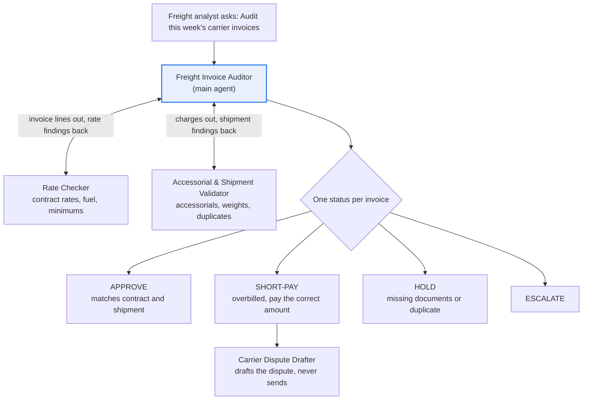

# Freight Invoice Audit agent

**Process:** Logistics and transportation (freight payment)

Carrier invoices are full of small errors: a rate that doesn't match the contract, a fuel surcharge from the wrong week, a detention charge when the truck was unloaded on time, a liftgate fee for a dock delivery, or the same shipment billed twice. Each is small, but across thousands of shipments they add up, and most teams only spot-check.

**POC question:** can an agent audit every carrier invoice against the contract and the shipment record, accurately enough that the freight team trusts its short-pay recommendations?

## Design

| Agent | Role |
| --- | --- |
| [Freight Invoice Auditor](main-agent.md) | Audits each invoice, totals overbilling, decides the status |
| [Rate Checker](subagents/1-rate-checker.md) | Re-rates the shipment from the contract and fuel table |
| [Accessorial & Shipment Validator](subagents/2-accessorial-shipment-validator.md) | Checks accessorial charges, weights and duplicates against shipment records |
| [Carrier Dispute Drafter](subagents/3-carrier-dispute-drafter.md) | Drafts the dispute for overbilled charges |

## Questions it answers

- Audit this week's invoices from Carrier A. Which ones are overbilled?
- Is the detention charge on PRO 7741902 valid?
- How much did we overpay on fuel surcharges last month?
- Which carriers have the highest overbilling rate?
- Have we been billed twice for any shipment?
- Draft a dispute for the overbilled charges on invoice 55120.

## Data it needs

| Data | What it contains | Typical source | Add as |
| --- | --- | --- | --- |
| Carrier invoices | Invoice, PRO or tracking number, line charges (linehaul, fuel, accessorials), amounts | Freight payment or AP export | Data source (Sheet) |
| Rate contracts | Carrier, lane or zone, mode, weight breaks, rate, minimum charge, valid dates | TMS or contracts | Data source (Sheet) |
| Fuel surcharge table | Surcharge % by fuel price range, and the weekly fuel price used | Carrier contract and published index | Data source (Sheet) |
| Shipment records | PRO, origin, destination, weight, pieces, pickup and delivery times, delivery type (dock or residential) | TMS export, bills of lading | Data source (Sheet) |
| Appointment and dwell times | Arrival, appointment, start and end of unloading | Yard or dock system | Data source (Sheet) |
| Accessorial rules | Allowed accessorials, rates, detention free time | Carrier contract | Knowledge (doc) |
| Paid invoice history | PRO, invoice, amount paid (last 12 months) | Freight payment export | Data source (Sheet) |

## POC success bar

Test with 30 invoices your team has already audited, including some known overbillings.

| Signal | Bar |
| --- | --- |
| Status matches the audited outcome | At least 25 of 30 |
| Re-rated amounts | Within $1 of the audited amount |
| Known overbillings caught | At least 90% |
| Invented rates or charges | Zero |

## Customize before use

Replace the placeholders: `$1.00` rounding tolerance, `$500` escalation limit, `2 hours` default detention free time. Use your contracts' terms.
