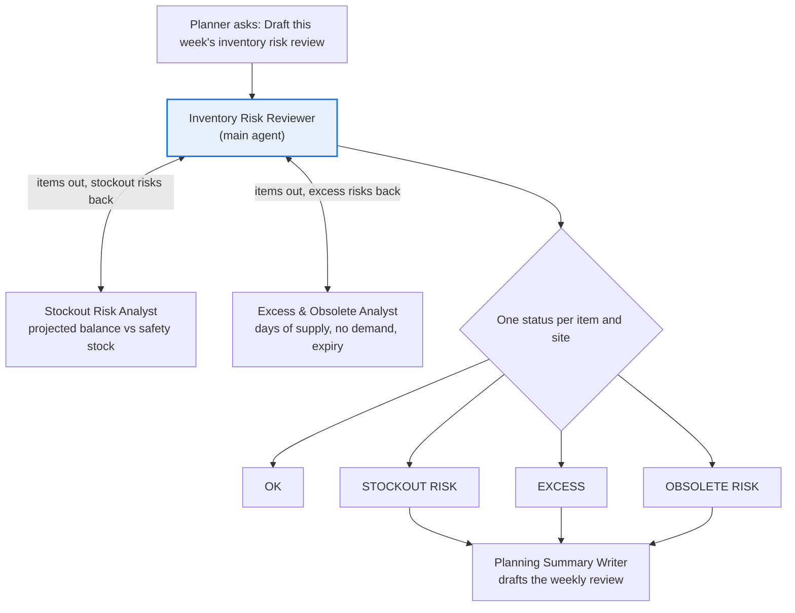

# Inventory Risk Review agent

**Process:** Supply and inventory planning

Every week, planners prepare for a review meeting by pulling inventory, supply and forecast reports and working out which items will run out and which are piling up. It takes hours, and the meeting still spends most of its time on finding the problems rather than deciding what to do about them.

**POC question:** can an agent find the items at risk of stocking out or becoming excess, explain why, and draft the weekly review, accurately enough that planners use it to run the meeting?

## Design

| Agent | Role |
| --- | --- |
| [Inventory Risk Reviewer](main-agent.md) | Runs both analyses, ranks risks, recommends actions |
| [Stockout Risk Analyst](subagents/1-stockout-risk-analyst.md) | Projects inventory forward and flags items that fall below safety stock |
| [Excess & Obsolete Analyst](subagents/2-excess-obsolete-analyst.md) | Flags items with too much supply, no demand or approaching expiry |
| [Planning Summary Writer](subagents/3-planning-summary-writer.md) | Drafts the weekly review for the planning meeting |

## Questions it answers

- Which items will fall below safety stock in the next 4 weeks, and where?
- Why is SKU-55500 at risk at the Atlanta distribution center?
- Could we cover the Atlanta shortage by moving stock from Dallas?
- Which items have more than 180 days of supply?
- Which items haven't sold in 6 months, and what are they worth?
- Draft this week's inventory risk review.

## Data it needs

| Data | What it contains | Typical source | Add as |
| --- | --- | --- | --- |
| Inventory snapshot | Item, site, on hand, allocated, safety stock | ERP or WMS export | Data source (Sheet) |
| Open supply | Purchase orders, transfers and production orders with quantities and due dates | ERP export | Data source (Sheet) |
| Demand forecast | Weekly forecast by item and site | Planning system export | Data source (Sheet) |
| Sales history | Actual weekly sales by item and site, last 12 months | ERP or BI export | Data source (Sheet) |
| Item master | Unit cost, lead time, shelf life, lifecycle status (active, phase-out) | ERP export | Data source (Sheet) |
| Expiry or lot data | Lots, quantities and expiry dates (for items with shelf life) | WMS export | Data source (Sheet) |
| Planning policy | Thresholds, review horizon, action options and owners | Internal | Knowledge (doc) |

## POC success bar

Look back: run the agent on data from 8 weeks ago and compare its flags with what actually happened.

| Signal | Bar |
| --- | --- |
| Actual stockouts flagged in advance | At least 80% |
| Stockout flags that didn't stock out | Under 30% |
| Projected balance calculations | Zero errors |
| Planners who'd use the draft to run the meeting | At least 2 of 3 |

## Customize before use

Replace the placeholders: `4-week` horizon, `180 days` of supply for excess, `6 months` with no demand for obsolete, `60 days` to expiry. Use your planning policy's numbers.
