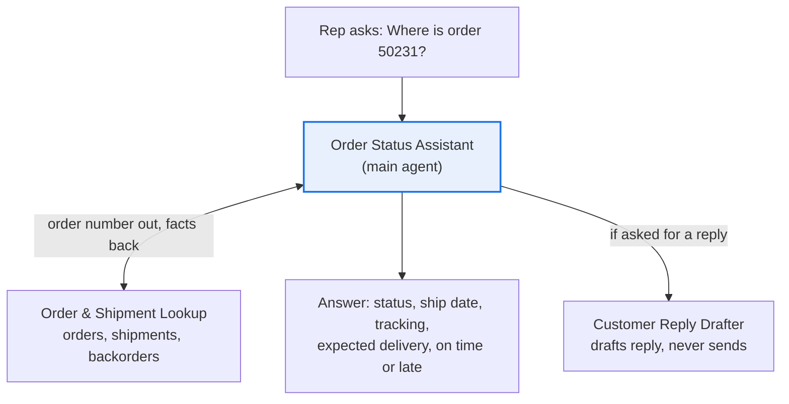

# Order Status Assistant ("Where is my order?")

**Process:** Order-to-cash (customer service)

The simplest useful supply chain agent, and the best one to build first. Customer service teams answer "Where is my order?" dozens of times a day by checking the ERP, the shipping system and backorder reports. This agent answers it in seconds, in plain language, from two spreadsheet exports.

It's read-only: it looks things up and explains them, and never changes an order.

**POC question:** can an agent answer order status questions correctly enough that reps stop checking the ERP by hand?

## Design

| Agent | Role |
| --- | --- |
| [Order Status Assistant](main-agent.md) | Identifies the order, gets the facts, answers in plain language |
| [Order & Shipment Lookup](subagents/1-order-shipment-lookup.md) | Finds order, shipment and backorder facts with sources |
| [Customer Reply Drafter](subagents/2-customer-reply-drafter.md) | Drafts a short reply the rep can send |

## Questions it answers

- Where is order 50231? Has it shipped?
- When will Acme's PO 7781 arrive, and what's the tracking number?
- Which of Northwind's open orders are late?
- Why hasn't order 50240 shipped yet?
- Draft a reply to the customer about order 50231.

## Data it needs

| Data | Columns | Typical source | Add as |
| --- | --- | --- | --- |
| Open orders | Order number, customer, customer PO, line, item, quantity, order date, promised date, status, hold reason | ERP order report | Data source (Sheet) |
| Shipments | Order number, ship date, carrier, tracking number, estimated delivery, delivery status | ERP, warehouse or shipping system | Data source (Sheet) |
| Backorders (optional) | Item, quantity short, expected availability date | ERP or planning report | Data source (Sheet) |
| Customer service guide | What each status and hold reason means, carrier tracking links, who to contact | Internal | Knowledge (doc) |

Refresh the exports daily during the pilot.

## POC success bar

Test with 20 orders your team answered questions about last week. Include split shipments, backorders, holds and an order number that doesn't exist.

| Check | Bar |
| --- | --- |
| Status, ship date and tracking number correct | 19 of 20 |
| Invented dates or tracking numbers | Zero |
| "Order not found" handled honestly | Every time |
| Time to answer vs looking it up by hand | At least half |
