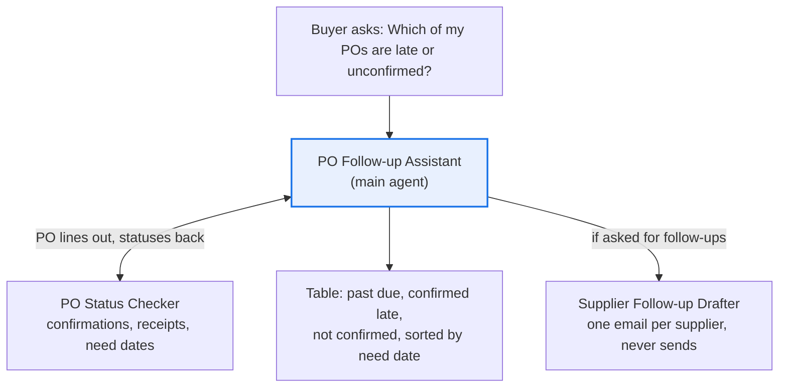

# PO Follow-up Assistant

**Process:** Procure-to-pay (purchasing)

**Start here.** This is the simplest business-critical supply chain agent. Every morning, buyers scan hundreds of open purchase order lines to find which suppliers haven't confirmed, which confirmed too late, and which deliveries are past due. Then they write follow-up emails one supplier at a time. When something slips through, a missing part can stop a production line or force expensive expedited freight.

This agent does that daily check in seconds and drafts the emails. It's read-only: it never changes a PO or contacts a supplier.

**POC question:** can an agent find every PO line that needs follow-up, accurately enough that buyers stop scanning the report by hand?

For the next step up, which also measures shortage impact using inventory and demand, see [Supplier Delay Early Warning](../supplier-delay-warning/).

## Design

| Agent | Role |
| --- | --- |
| [PO Follow-up Assistant](main-agent.md) | Sets the scope, gets statuses, shows what needs attention |
| [PO Status Checker](subagents/1-po-status-checker.md) | Classifies each line: received, past due, confirmed late, not confirmed, short, on track |
| [Supplier Follow-up Drafter](subagents/2-supplier-follow-up-drafter.md) | Drafts one follow-up email per supplier |

## Questions it answers

- Which of my PO lines are late or not yet confirmed?
- What's the status of PO 4100231?
- Which suppliers haven't confirmed orders we sent more than 3 days ago?
- What's due in the next two weeks that isn't confirmed on time?
- Draft a follow-up email to Contoso Metals for all their late lines.

## Data it needs

| Data | Columns | Typical source | Add as |
| --- | --- | --- | --- |
| Open PO lines | PO number, line, supplier, item, quantity, order date, need date, buyer | ERP purchasing report | Data source (Sheet) |
| Supplier confirmations | PO number, line, confirmed quantity, confirmed delivery date | ERP, supplier portal or EDI acknowledgments | Data source (Sheet) |
| Goods receipts (optional) | PO number, line, received quantity, receipt date | ERP or warehouse report | Data source (Sheet) |
| Follow-up guide | Days suppliers have to confirm, supplier contacts, escalation rules | Internal | Knowledge (doc) |

Refresh the exports daily during the pilot.

## Try it with sample data

[`sample-data/`](sample-data/) has a fictional dataset: 20 PO lines across 6 suppliers, covering every status. It includes the three spreadsheets, a follow-up guide to upload as Knowledge, a computed [answer key](sample-data/answer_key.csv), and a [test script](sample-data/TESTING.md) with nine questions and their correct answers.

To load it: in Google Drive, upload each CSV and open it with Google Sheets (or use **File > Import** in a blank sheet). Then attach the three sheets in **Add data sources & tools**.

## POC success bar

Run the agent on last Monday's open PO report. Your buyers already know which lines turned into problems; that's your answer key.

| Check | Bar |
| --- | --- |
| Lines that needed follow-up and were flagged | At least 95% |
| Status and days late calculated correctly | Every line checked |
| Invented confirmation dates or quantities | Zero |
| Time for a buyer's morning PO review | At least half |
