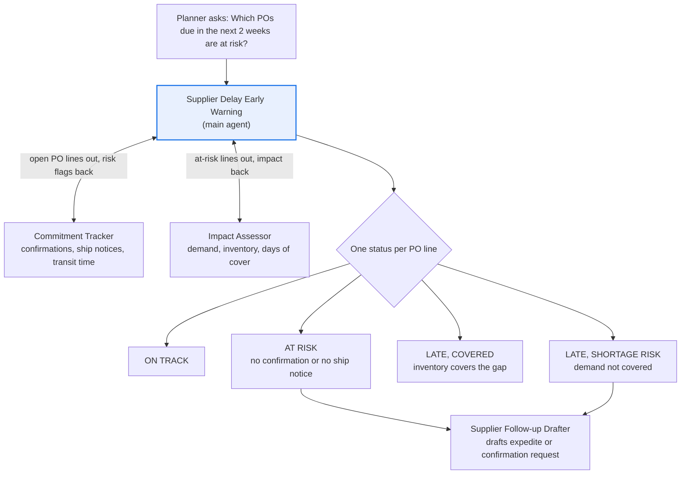

# Supplier Delay Early Warning agent

**Process:** Procure-to-pay and supply planning

Planners find out about late supplier shipments too late, often when the receiving dock is empty on the day production needs the parts. The signals were there earlier: a PO the supplier never confirmed, a confirmed date later than the need date, or a ship notice that never arrived. Nobody has time to check every open PO line every day.

**POC question:** can an agent spot at-risk supplier orders early and rank them by business impact, accurately enough that planners act on its list?

## Design

| Agent | Role |
| --- | --- |
| [Supplier Delay Early Warning](main-agent.md) | Scans open PO lines, combines risk and impact, ranks what needs action |
| [Commitment Tracker](subagents/1-commitment-tracker.md) | Checks each line's confirmation, ship notice and transit time against the need date |
| [Impact Assessor](subagents/2-impact-assessor.md) | Works out whether a late line causes a shortage, using inventory and demand |
| [Supplier Follow-up Drafter](subagents/3-supplier-followup-drafter.md) | Drafts expedite and confirmation requests to suppliers |

## Questions it answers

- Which PO lines due in the next two weeks are at risk?
- Which suppliers haven't confirmed POs sent more than 3 business days ago?
- If PO 4100231 arrives a week late, which production or customer orders are affected?
- What's our shortage exposure from Supplier X this month?
- Which late shipments are covered by inventory, and which aren't?
- Draft an expedite request for PO 4100231 line 2.

## Data it needs

| Data | What it contains | Typical source | Add as |
| --- | --- | --- | --- |
| Open PO lines | PO, line, supplier, item, quantity, order date, need date | ERP export | Data source (Sheet) |
| Supplier confirmations | Confirmed quantity and date per PO line (for example, from EDI 855) | ERP or EDI translator export | Data source (Sheet) |
| Ship notices | Shipped quantity, ship date, carrier, tracking per PO line (for example, from EDI 856) | ERP, EDI or TMS export | Data source (Sheet) |
| Transit lead times | Days in transit by supplier and lane | Planning parameters | Data source (Sheet) |
| Inventory | On hand, allocated and safety stock by item and site | ERP or WMS export | Data source (Sheet) |
| Demand | Production orders and customer orders that need each item, with dates | ERP or MRP export | Data source (Sheet) |
| Supplier contacts and policy | Contacts, confirmation and expedite rules, owners | Internal | Knowledge (doc) |

## POC success bar

Look back at a past month: run the agent on the open PO lines as they stood at the start, and compare with what actually arrived late.

| Signal | Bar |
| --- | --- |
| Late lines flagged at least 5 days before the need date | At least 70% |
| Flagged lines that actually arrived on time (false alarms) | Under 30% |
| Shortage-risk lines ranked in the top 10 | All of them |
| Invented dates or quantities | Zero |

## Customize before use

Replace the placeholders: `3 business days` to confirm, `2 days` before the expected ship date for a missing ship notice, `14-day` default horizon. Use your planning policy's numbers.
