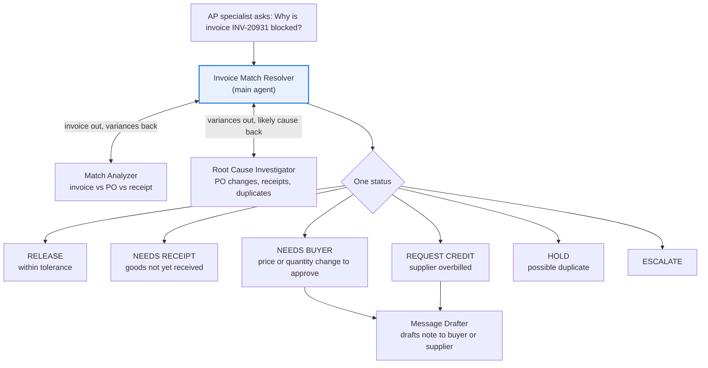

# Three-Way Match Exceptions agent

**Process:** Procure-to-pay (accounts payable)

Before a supplier invoice is paid, it is matched against the purchase order and the goods receipt. When the three don't agree on quantity or price, the invoice is blocked. AP specialists then chase buyers, receiving teams and suppliers to find out why. Blocked invoices delay payments, hurt supplier relationships, and can miss early-payment discounts.

**POC question:** can an agent explain why a blocked invoice doesn't match and route it to the person who can fix it, accurately enough that AP trusts it and clears blocks faster?

## Design

| Agent | Role |
| --- | --- |
| [Invoice Match Resolver](main-agent.md) | Finds the blocked invoice, gets the variances and cause, decides the status |
| [Match Analyzer](subagents/1-match-analyzer.md) | Compares invoice, PO and receipt line by line, applying tolerances |
| [Root Cause Investigator](subagents/2-root-cause-investigator.md) | Checks PO change history, pending receipts, unit of measure and duplicates |
| [Message Drafter](subagents/3-message-drafter.md) | Drafts the note to a buyer or a credit-memo request to a supplier |

## Questions it answers

- Why is invoice INV-20931 from Contoso Metals blocked?
- Which blocked invoices are waiting only on a goods receipt?
- Which blocks need buyer approval for a price change, and who is the buyer?
- Is invoice INV-20977 a duplicate of something we already paid?
- Which suppliers cause the most price variances this month?
- Draft a credit memo request for the overbilled lines on INV-20931.

## Data it needs

| Data | What it contains | Typical source | Add as |
| --- | --- | --- | --- |
| Blocked invoices | Invoice number, supplier, lines, quantity, unit price, amount, block reason | AP exception queue export | Data source (Sheet) |
| Purchase order lines | PO number, line, item, ordered quantity, unit, price, buyer | ERP export | Data source (Sheet) |
| PO change history | Changes to price or quantity, with dates and who approved them | ERP change log | Data source (Sheet) |
| Goods receipts | PO line, received quantity, receipt date | ERP or WMS export | Data source (Sheet) |
| Supplier master | Supplier contacts, payment terms, early-payment discount terms | ERP export | Data source (Sheet) |
| Paid invoice history | Supplier, invoice number, amount, date paid (last 12 months) | AP export | Data source (Sheet) |
| AP match policy | Price and quantity tolerances, approval rules, owners | Internal | Knowledge (doc) |

## POC success bar

Test with 20 blocked invoices your team has already cleared.

| Signal | Bar |
| --- | --- |
| Status matches how the block was actually cleared | At least 16 of 20 |
| Variance calculations | Zero errors |
| Duplicates caught | All planted duplicates |
| Invented PO, receipt or price data | Zero |

## Customize before use

Replace the placeholders: `2%` price tolerance, `5%` quantity tolerance, `$5,000` escalation limit, and the `30-day` window for duplicate checks. Use your AP policy's numbers.
